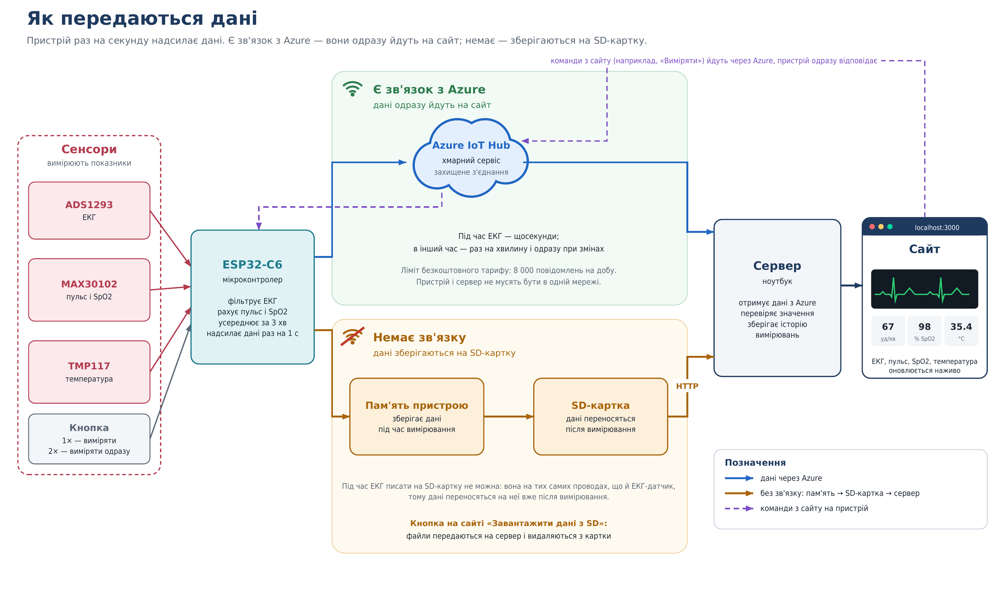

<h1 align="center">Medical IoT Device</h1>
<p align="center"><i>Проєкт з курсу «Принципи організації комп’ютера»</i></p>
<div align="center">
  <a href="https://github.com/Sviat-Vol">Святослав Волянюк</a>,
  <a href="https://github.com/alinlinss">Аліна Дерев'ягіна</a>,
  <a href="https://github.com/SherbynaEugene">Євгеній Щербина</a>,
  <a href="https://github.com/milka-side">Мілана Катрич</a>

<a href="mailto:yevgeniy@karplyuk.kiev.ua">Ментор: Євгеній Карплюк</a>
</div>


---

Medical IoT Device — компактний носимий IoT-пристрій, який вимірює базові життєві показники: **ЕКГ**, **пульс**, **насичення крові киснем (SpO₂)** і **температуру**. Пристрій обробляє сигнали на мікроконтролері й передає результати у вебпанель через хмару **Azure IoT Hub**. Коли зв'язку немає, дані зберігаються на SD-картку й завантажуються пізніше.

> ⚠️ Це навчальний проєкт, а не медичний прилад. Калібрування виконано на одній людині без еталонних приладів, тому показники не можна використовувати для діагностики.

---

## Зміст
- [Огляд](#огляд)
- [Як проходить вимірювання](#як-проходить-вимірювання)
- [Обробка сигналів](#обробка-сигналів)
- [Передача даних](#передача-даних)
- [Структура репозиторію](#структура-репозиторію)
- [Перелік компонентів](#перелік-компонентів)
- [Прошивка](#прошивка)
- [Запуск сервера](#запуск-сервера)
- [Azure IoT Hub](#azure-iot-hub)
- [Формат даних і API](#формат-даних-і-api)
- [Обмеження](#обмеження)
- [План розвитку](#план-розвитку)
- [Контакти](#контакти)
- [Джерела](#джерела)

---

## Огляд

### Про що наш проєкт?
Мета проєкту — створити невеликий носимий пристрій з автономним живленням, який збирає життєві показники, виконує первинну обробку даних і передає результати до системи моніторингу. Дані доступні у вебінтерфейсі майже в реальному часі, а кожне вимірювання зберігається в історії. Така система корисна для навчання й демонстрації віддаленого моніторингу пацієнтів, але не призначена для ухвалення медичних рішень.

### Показники, що вимірюються
| Показник    | Сенсор   | Тривалість | Що показує вебпанель                                                        |
|-------------|----------|------------|------------------------------------------------------------------------------|
| ЕКГ         | ADS1293  | 10 хв      | Живий графік, відведення I, 200 відліків/с після цифрової фільтрації         |
| Пульс       | MAX30102 | 3 хв       | Середнє за 3 хв, уд/хв                                                       |
| SpO₂        | MAX30102 | 3 хв       | Середнє за 3 хв, %                                                           |
| Температура | TMP117   | 3 хв       | Виміряна температура пальця (усталена частина) + орієнтовна температура тіла |

### Архітектура системи


```
 сенсори ─▶ XIAO ESP32-C6 ── MQTT/TLS ─▶ Azure IoT Hub ── AMQP ─▶ сервер (Node.js) ─WebSocket─▶ вебпанель
            (обробка,                       ▲                          │
             JSON раз на 1 с)               └─ команди (direct method) ┘ історія: web/data/
                │ немає зв'язку
                ▼
          флеш 1 МБ ─▶ SD-картка ─▶ (кнопка «Завантажити дані з SD») ─HTTP─▶ сервер
```

### Стан проєкту
- **Поточна версія:** робочий прототип, перевірений на реальній платі.
- **Стан розробки:** активна розробка.
- **Останнє оновлення:** 19.11.2026

### Команда
- [Святослав Волянюк](https://github.com/Sviat-Vol)
- [Аліна Дерев'ягіна](https://github.com/alinlinss)
- [Євгеній Щербина](https://github.com/SherbynaEugene)
- [Мілана Катрич](https://github.com/milka-side)

Ментор: Євгеній Карплюк.

---

## Як проходить вимірювання

- **Прогрів.** Перші 10 хвилин після ввімкнення вимірювання автоматично не запускаються: сенсори мають прогрітися. Вебпанель показує зворотний відлік і кнопку **«Виміряти все одно»**.
- **Запуск.**
  - Кнопка на пристрої: **1 натискання** — виміряти все (після прогріву), **2 натискання за 0,7 с** — виміряти все одно, навіть під час прогріву.
  - Кнопки у вебпанелі: окремо ЕКГ, пульс + SpO₂, температура, усе разом, «виміряти все одно».
- **Вікна вимірювання.** Кожен сенсор працює свій фіксований час (ЕКГ 10 хв, пульс/SpO₂ 3 хв, температура 3 хв), паралельно з іншими, і потім вимикається. Між вимірюваннями ADS1293 у standby, MAX30102 у shutdown.
- **Результати.** Графік ЕКГ видно наживо. Пульс, SpO₂ і температура з'являються одним числом наприкінці свого вікна — середнім за вимірювання.
- **Історія.** Кожна сесія вимірювання (повна ЕКГ + середні показники) зберігається на сервері в `web/data/` і доступна у вебпанелі. Термін зберігання налаштовується (1–365 днів, за замовчуванням 30).

---

## Обробка сигналів

Уся обробка виконується на ESP32-C6, на сервер ідуть готові значення.

### ЕКГ (ADS1293)
- Відведення I (IN3 − IN2), драйвер правої ноги (RLD) на IN1, детектор відриву електродів на обох сенсорних електродах.
- АЦП: 102 400 Гц / (4·4·8) = **800 відліків/с**, 24 біти.
- Цифрові фільтри (смуга 0,5–40 Гц, стандартна для моніторного режиму):

| Етап | Тип | Параметри |
|------|-----|-----------|
| Фільтр верхніх частот 0,5 Гц — прибирає дрейф лінії | IIR 1-го порядку (EMA-базова лінія) | α = 0,003919 |
| Режекторний фільтр 50 Гц — прибирає наведення мережі | IIR 2-го порядку (біквад), ширина ≈4 Гц | r = 0,953 |
| Фільтр нижніх частот 40 Гц — прибирає шум | IIR 1-го порядку | α = 0,2696 |
| Децимація 800 → 200 відліків/с | FIR (середнє 4 відліків) | захист від аліасингу |

### Пульс і SpO₂ (MAX30102)
- 100 відліків/с, червоний та ІЧ світлодіоди ≈7 мА, вікно розрахунку 8 с.
- Смуговий фільтр 0,5–6 Гц, перевірка наявності пальця.
- Пульс — нормована автокореляція (35–180 уд/хв) з порогом якості 0,5.
- SpO₂ — відношення відношень R = (AC/DC)<sub>red</sub> / (AC/DC)<sub>IR</sub>, SpO₂ = A − B·R (A = 114,30, B = 25,00, калібрування за однією точкою).
- Результат — середнє всіх достовірних значень за 3 хв.

### Температура (TMP117)
- Виміряна температура — середнє усталеної частини 3-хвилинного вікна (після того, як показ змінюється менше ніж на 0,1 °C за 20 с).
- Орієнтовна температура тіла: `T_тіла = T_шкіри + k·(T_шкіри − T_кімнати)`, k = 0,19. Температуру кімнати той самий датчик вимірює між вимірюваннями.

---

## Передача даних

Раз на секунду пристрій формує один JSON-пакет і, якщо є Wi-Fi, відправляє його в **Azure IoT Hub**:
- пристрій → хаб: MQTT 3.1.1 поверх TLS, порт 8883, SAS-токен, який плата сама генерує з рядка підключення й оновлює кожні 24 год;
- хаб → сервер: вбудований Event Hub-сумісний endpoint, протокол AMQP;
- сервер → вебпанель: WebSocket.

Під час вимірювання пакети йдуть щосекунди, у режимі очікування — лише 1 статус на хвилину (ліміт безкоштовного рівня F1). Кожен пакет має `boot` + `seq`, тому повторно доставлені повідомлення сервер відкидає. Сервер і плата можуть бути в різних мережах — потрібен лише інтернет.

HTTP використовується тільки для завантаження файлів із SD-картки.

### Офлайн-режим (SD-картка)
SD-картка використовується лише тоді, коли плата не підключена до Azure IoT Hub (немає Wi-Fi чи інтернету):
1. Під час вимірювання пакети, які не вдалося відправити, записуються у флеш-розділ `measbuf` (1 МБ).
2. Після вимірювання вони переносяться на SD-картку у файл `meas_NNNNN.jsonl`. Під час ЕКГ писати на картку не можна: вона спільно з ADS1293 використовує шину SPI і перестає відповідати.
3. Коли зв'язок повернувся, кнопка у вебпанелі **«Завантажити дані з SD»** відправляє файли напряму на сервер по HTTP частинами по 8 КБ (`POST /api/sd-upload`). Для цього плата й ноутбук мають бути в одній мережі. Кожен файл видаляється з картки лише після підтвердження сервером.

### Команди з вебпанелі
Сервер викликає на пристрої **direct method** `command` через Azure IoT Hub: пристрій одразу відповідає `200` (прийнято) або `409` з причиною (`warmup` — іде прогрів, `measuring` — SD недоступна під час вимірювання). Якщо пристрій не підключений до хаба, вебпанель одразу про це повідомляє.

---

## Структура репозиторію
```
.
├── README.md
├── firmware                  прошивка ESP32-C6 (ESP-IDF)
│   ├── main
│   │   ├── main.c            вікна вимірювань, кнопка, відправлення, офлайн-логіка
│   │   ├── ads1293.c         ЕКГ і цифрові фільтри
│   │   ├── max30102.c        пульс і SpO₂
│   │   ├── tmp117.c          температура
│   │   ├── sd_logger.c       SD-картка
│   │   ├── offline_log.c     флеш-буфер на час вимірювання
│   │   ├── sd_upload.c       завантаження файлів із SD на сервер
│   │   ├── telemetry_http.c  HTTP-запити для завантаження з SD
│   │   ├── telemetry_azure.c Azure IoT Hub (телеметрія + direct methods)
│   │   ├── device_commands.c розбір команд
│   │   ├── wifi_connect.c    Wi-Fi
│   │   └── pins.h            розпіновка
│   ├── partitions.csv        таблиця розділів (зокрема measbuf, 1 МБ)
│   └── sdkconfig.defaults    налаштування збірки та калібрування
├── web                       сервер і вебпанель
│   ├── server.js             HTTP API, WebSocket, завантаження з SD
│   ├── src                   перевірка даних, розсилка, історія, Azure, команди
│   └── public                вебпанель (HTML, CSS, JS)
├── tools                     віртуальний пристрій для Azure (демо без плати)
└── cad_model                 3D-модель корпуса (Autodesk Fusion) і STL-файли
```

---

## Перелік компонентів

| Категорія       | Компонент           | Специфікація             | Кількість | Примітки                                  |
|-----------------|---------------------|--------------------------|-----------|-------------------------------------------|
| **Електроніка** | Мікроконтролер      | Seeed XIAO ESP32-C6      | 1         | Wi-Fi, обробка сигналів                   |
|                 | ЕКГ                 | TI ADS1293               | 1         | SPI, 3 електроди                          |
|                 | Пульсоксиметр       | MAX30102                 | 1         | I²C, пульс і SpO₂                         |
|                 | Датчик температури  | TI TMP117                | 1         | I²C, ±0,1 °C                              |
|                 | Модуль microSD      | SDHC 16 ГБ               | 1         | SPI, офлайн-архів                         |
|                 | Кнопка              | модуль кнопки            | 1         | ручний запуск вимірювання, живлення 3,3 В |
| **Живлення**    | Акумулятор          | LiPo                     | 1         | із заряджанням                            |
| **Інше**        | Корпус              | 3D-друк                  | 1         | модель в Autodesk Fusion                  |

### Розпіновка
| Сигнал | GPIO | Пін XIAO |
|--------|------|----------|
| SPI SCK / MOSI (ADS1293 і SD, спільні) | 19 / 18 | D8 / D10 |
| MISO ADS1293 / MISO SD (окремі лінії) | 20 / 2 | D9 / D2 |
| CS ADS1293 / CS SD | 17 / 21 | D7 / D3 |
| DRDY ADS1293 | 16 | D6 |
| I²C SDA / SCL (MAX30102 + TMP117) | 22 / 23 | D4 / D5 |
| Кнопка (0 у спокої, 1 при натисканні) | 1 | D1 |

SD-модуль у неактивному стані підтягує свою MISO до 1, тому ADS1293 має окрему лінію даних: драйвер перемикає вхід MISO через GPIO-матрицю на кожну транзакцію.

---

## Прошивка

Прошивка написана на C під ESP-IDF v5.4. Збирати можна встановленим ESP-IDF або через Docker без встановлення:

```bash
cd firmware
docker run --rm -e SDKCONFIG_DEFAULTS="sdkconfig.defaults;sdkconfig.defaults.local" \
  -v "$PWD":/project -w /project espressif/idf:v5.4 idf.py build
docker run --rm --device=/dev/ttyACM0 -e SDKCONFIG_DEFAULTS="sdkconfig.defaults;sdkconfig.defaults.local" \
  -v "$PWD":/project -w /project espressif/idf:v5.4 idf.py -p /dev/ttyACM0 flash
```

Основні налаштування — у `firmware/sdkconfig.defaults` (Wi-Fi, адреса сервера, калібрування) або `idf.py menuconfig` → *Medical IoT Device*. **Адреса сервера** (`CONFIG_MIOT_SERVER_URL`) — IP ноутбука з сервером; потрібна лише для завантаження файлів із SD-картки.

Секрет (рядок підключення Azure) записується лише в `firmware/sdkconfig.defaults.local`, який є в `.gitignore`:

```
CONFIG_MIOT_AZURE_ENABLE=y
CONFIG_MIOT_AZURE_CONNECTION_STRING="HostName=<hub>.azure-devices.net;DeviceId=<device>;SharedAccessKey=<key>"
```

Defaults застосовуються лише до ключів, яких ще немає в `sdkconfig`, тому після їх зміни потрібно видалити `firmware/sdkconfig` і зібрати заново.

---

## Запуск сервера

Потрібен Node.js 18 або новіший.

```bash
cd web
npm install
npm start                  # ключі Azure беруться з web/.azure.env
# вебпанель: http://localhost:3000
```

Демонстрація без апаратної частини (в іншому терміналі, з каталогу `web/`): `npm run mock` — віртуальний пристрій шле тестові дані в Azure IoT Hub.

| Змінна | Призначення |
|--------|-------------|
| `PORT`, `HOST` | адреса сервера (за замовчуванням `0.0.0.0:3000`) |
| `API_KEY` | вмикає перевірку `X-API-Key` для завантажень із SD |
| `DATA_DIR` | де зберігати історію (за замовчуванням `web/data`) |
| `AZURE_EVENTHUB_CONNECTION_STRING`, `AZURE_EVENTHUB_NAME`, `AZURE_EVENTHUB_CONSUMER_GROUP` | приймання телеметрії з Azure IoT Hub |
| `AZURE_DEVICE_CONNECTION_STRING`, `AZURE_IOTHUB_CONNECTION_STRING`, `AZURE_COMMAND_DEVICE_ID` | команди через direct methods |

Файл `web/.azure.env` і папка `web/data/` (дані пацієнтів) у `.gitignore`.

---

## Azure IoT Hub

Потрібен [Azure CLI](https://learn.microsoft.com/cli/azure/install-azure-cli) і `az login`.

```bash
RG=medical-iot-rg
HUB_NAME=medical-iot-hub-<щось-унікальне>
DEVICE_ID=esp32c6-01
LOCATION=westeurope

az extension add --name azure-iot
az group create --name $RG --location $LOCATION
az iot hub create --name $HUB_NAME --resource-group $RG --sku F1 --partition-count 2   # F1 — безкоштовний, один на підписку
az iot hub device-identity create --hub-name $HUB_NAME --device-id $DEVICE_ID

# рядок підключення пристрою — у firmware/sdkconfig.defaults.local і web/.azure.env (AZURE_DEVICE_CONNECTION_STRING)
az iot hub device-identity connection-string show --hub-name $HUB_NAME --device-id $DEVICE_ID --output tsv
# Event Hub-сумісний endpoint і його назва — у web/.azure.env
az iot hub connection-string show --hub-name $HUB_NAME --default-eventhub --output tsv
az iot hub show --name $HUB_NAME --query "properties.eventHubEndpoints.events.path" --output tsv
```

`web/.azure.env`:
```
AZURE_EVENTHUB_CONNECTION_STRING="Endpoint=sb://...;SharedAccessKeyName=iothubowner;SharedAccessKey=...;EntityPath=..."
AZURE_EVENTHUB_NAME="<назва endpoint>"
AZURE_DEVICE_CONNECTION_STRING="HostName=<hub>.azure-devices.net;DeviceId=<device>;SharedAccessKey=<key>"
```

Рядок підключення сервісу для direct methods сервер складає сам з адреси хаба та ключа `iothubowner`.

**Ліміт F1:** 8 000 повідомлень на добу. Коли ліміт вичерпано, хаб перестає приймати повідомлення до наступної доби. Пакет з ЕКГ ≈1,2 КБ, тому повна 10-хвилинна ЕКГ витрачає приблизно 1 800 одиниць ліміту — це ≈3–4 повні ЕКГ на добу. Ліміт оновлюється опівночі за UTC.

---

## Формат даних і API

Пакет, який пристрій надсилає в Azure IoT Hub щосекунди:

```json
{
  "device_id": "esp32c6-01", "boot": 2846113451, "seq": 1874,
  "fs": 200.0, "ecg": [1532, 1540, 1561],
  "hr": 67, "spo2": 98,
  "temp": 35.43, "temp_body": 36.68, "temp_room": 28.83,
  "status": "measuring", "ecg_remaining_s": 312,
  "lod": 0, "adc_sps": 800, "sd_files": 0
}
```

| Поле | Опис |
|------|------|
| `device_id` | ідентифікатор пристрою |
| `boot`, `seq` | номер запуску і номер пакета (для відкидання повторів) |
| `fs`, `ecg` | частота (200 Гц) і відліки ЕКГ за секунду |
| `hr`, `spo2` | пульс і SpO₂ — середнє за вимірювання, лише наприкінці вікна |
| `temp`, `temp_body`, `temp_room` | виміряна температура, орієнтовна температура тіла, температура кімнати |
| `status` | `idle`, `boot_lockout` або `measuring` |
| `lockout_remaining_s`, `ecg_remaining_s`, `vitals_remaining_s`, `temp_remaining_s` | скільки секунд залишилось до кінця прогріву або вікна |
| `lod` | відрив електродів: біт 0 — RA, біт 1 — LA |
| `adc_sps` | фактична частота АЦП ADS1293 |
| `sd_files` | кількість файлів вимірювань на SD-картці (`-1` — картки немає) |


| Метод | Шлях | Опис |
|-------|------|------|
| POST | `/api/sd-upload` | файли з SD-картки частинами (пристрій) |
| POST | `/api/command` | команда пристрою з вебпанелі через Azure direct method (`ecg`, `vitals`, `temp`, `all`, `all_force`, `sd_upload`) |
| GET, POST | `/api/settings` | налаштування історії (автозбереження, термін зберігання) |
| GET | `/api/history`, `/api/history/:id` | список збережених вимірювань і повний запис |
| POST | `/api/history/save` | зберегти поточну сесію вручну |
| DELETE | `/api/history/:id` | видалити запис |
| GET | `/api/latest`, `/api/session` | останні значення і поточна сесія |
| GET | `/api/health` | стан сервера, кількість отриманих пакетів |
| WS | `/ws` | потік даних для вебпанелі |

---

## Обмеження

- **SpO₂** відкалібровано за однією точкою (≈98 %) без еталонного пульсоксиметра.
- **Температура тіла** — оцінка за температурою пальця; k = 0,19 визначено на одній людині.
- **ЕКГ** — одне відведення в смузі 0,5–40 Гц: видно ритм і пульс, але не дрібні деталі форми хвиль.
- **Спільна шина SPI:** під час ЕКГ SD-картка недоступна. Повне рішення — окремі SCK/MOSI для картки.
- **Адреса ноутбука** прописана в прошивці: якщо IP змінився, завантаження з SD не працюватиме до перепрошивки. Живі дані йдуть через Azure з будь-якої мережі.
- **Завантаження з SD** по HTTP без шифрування, розраховане на довірену локальну мережу.
- **Енергозбереження процесора** вимкнене (з ним плата втрачала зв'язок по USB); економія енергії — за рахунок вимкнених між вимірюваннями сенсорів і сну Wi-Fi.

---

## План розвитку

### Виконано
- Прошивка для всіх сенсорів, перевірена на реальній платі.
- Цифрові фільтри ЕКГ, розрахунок пульсу, SpO₂ і оцінки температури тіла на пристрої.
- Вимірювання на вимогу: кнопка на пристрої та у вебпанелі, прогрів після ввімкнення.
- Передача даних через Azure IoT Hub.
- Команди з вебпанелі через Azure direct methods.
- Офлайн-режим: флеш-буфер, SD-картка, завантаження файлів на сервер.
- Вебпанель з історією вимірювань.
- Принципова схема та 3D-модель корпуса з місцем для кнопок і SD-модуля.

### Наступні кроки
1. Автоматично перезапускати ADS1293, якщо відліки зникають (після роботи з SD-карткою на спільній шині).
2. Позбутися жорстко прописаної адреси сервера (сервер повідомляє адресу через Azure).
3. Зберігати дані в хмарі (маршрутизація IoT Hub → Blob Storage), щоб нічого не губилось при вимкненому сервері.
4. Перевірити калібрування SpO₂ і температури на кількох людях з еталонними приладами.
5. Потім: аналіз HRV та аритмій, виявлення гіпоксії.

---

## Контакти

### Розробники
Студенти факультету прикладних наук Українського католицького університету:
- Святослав Волянюк - [volianiuk.pn@ucu.edu.ua](mailto:volianiuk.pn@ucu.edu.ua);
- Аліна Дерев'ягіна - [derevyagina.pn@ucu.edu.ua](mailto:derevyagina.pn@ucu.edu.ua);
- Євгеній Щербина - [shcherbyna.pn@ucu.edu.ua](mailto:shcherbyna.pn@ucu.edu.ua);
- Мілана Катрич - [katrych.pn@ucu.edu.ua](mailto:katrych.pn@ucu.edu.ua).

### Ментор
- Євгеній Карплюк - [yevgeniy@karplyuk.kiev.ua](mailto:yevgeniy@karplyuk.kiev.ua).

---

## Джерела
- [ESP32-C6](https://www.espressif.com/en/products/socs/esp32-c6), Espressif Systems
- [ESP-IDF](https://docs.espressif.com/projects/esp-idf/en/v5.4/esp32c6/), Espressif Systems
- [ADS1293](https://www.ti.com/product/ADS1293), Texas Instruments
- [MAX30102](https://www.analog.com/en/products/max30102.html), Analog Devices
- [TMP117](https://www.ti.com/product/TMP117), Texas Instruments
- [Azure IoT Hub](https://learn.microsoft.com/azure/iot-hub/), Microsoft
- [Документація Node.js](https://nodejs.org/docs/)
